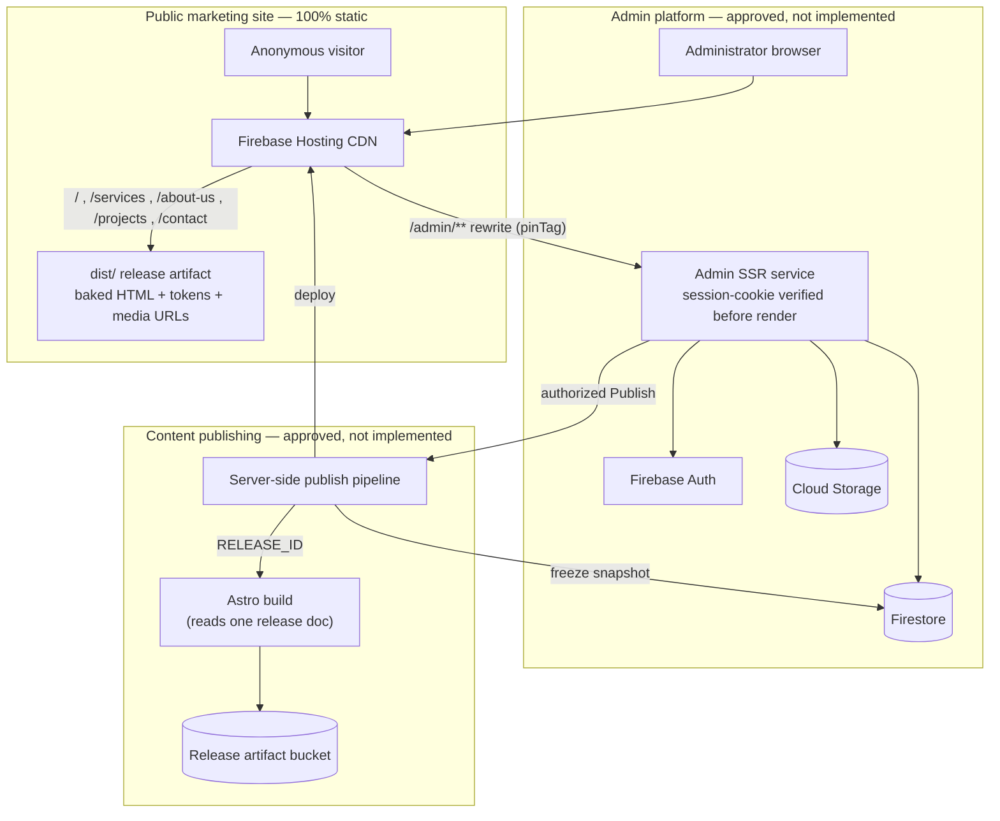
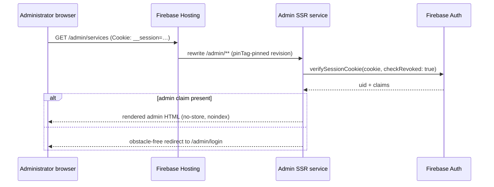
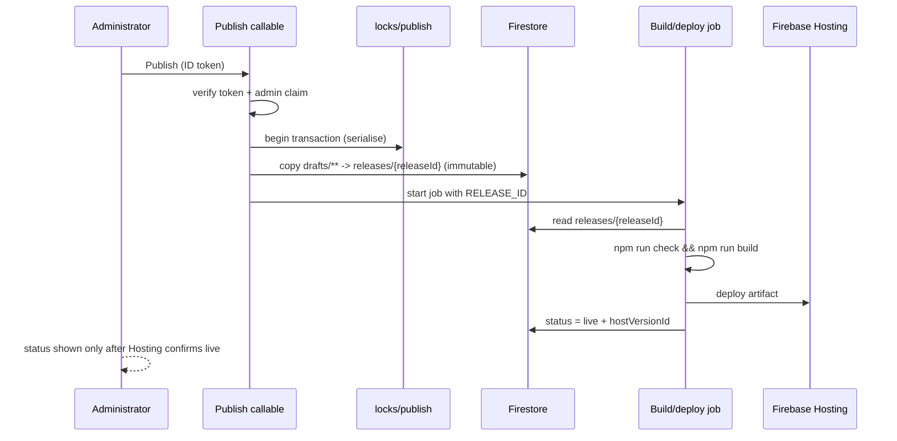

# ARCHITECTURE.md

Full-stack architecture for the Rajarata Engineering website and CMS.

This file is the committed record of how the system is put together and *why*. It
supersedes the Phase 12 decision text in `IMPLEMENTATION.md`, which is a
local-only planning document. Where the two disagree, this file wins.

**Owner approval:** the Phase 12 decisions marked **APPROVED** below were
confirmed by the owner on 2026-10-14.

## Status legend

| Tag | Meaning |
| --- | --- |
| `implemented` | Exists in this checkout and builds today. |
| `approved` | Decided and agreed, but **no code or infrastructure exists yet**. |
| `planned` | Scheduled in `IMPLEMENTATION.md` Phases 13–19. Nothing built. |
| `open` | Needs a decision or a fact from the owner. Do not assume an answer. |

> **Nothing tagged `approved` or `planned` is implemented.** No Firebase project
> has been created or changed, there are no rules beyond `firestore.rules`, no
> CI, no hosting configuration, and no deployment has ever been performed.

---

## 1. System overview



**Two delivery paths, one codebase.**

| Path | Content | Delivery |
| --- | --- | --- |
| Public site | Marketing pages, tokens, published media | Fully static `dist/` on Firebase Hosting's CDN |
| Admin platform | Editors, lists, media library, preview, publish, history | On-demand Astro app behind a Hosting rewrite, verified per request |

The public site is deliberately **not** server-rendered. It stays static so it
remains fast, crawlable, and cheap, and so Firebase Hosting serves it exactly as
it does today. Only `/admin/**` is dynamic.

---

## 2. Stack

Fixed. Do not substitute a layer without asking first.

| Layer | Choice | Status |
| --- | --- | --- |
| Front-end | Astro 7 + Tailwind CSS 4 (CSS-first `@theme`, no `tailwind.config.js`) | `implemented` |
| Admin dynamic rendering | Astro on-demand rendering (`@astrojs/node` standalone or equivalent) | `approved` |
| Database | Firebase Firestore | `planned` |
| Auth | Firebase Auth, admin-only via the `admin` custom claim | `planned` |
| Files | Firebase Storage | `planned` |
| Functions | Cloud Functions (contact form, session cookie, publish trigger) | `planned` |
| Hosting | Firebase Hosting — static `dist/` for the public site, rewrite for `/admin/**` | `approved` |
| CI/CD | GitHub Actions on merge to `main` for **code**; server-side pipeline for **content** | `approved` |

No client-side UI framework. Interactivity is progressive enhancement in small
TypeScript modules and inline `<script>` blocks. No `.astro` component may ship
an inline `<style>` block.

---

## 3. Front-end architecture

### 3.1 Layouts

| File | Role | Status |
| --- | --- | --- |
| `src/layouts/Base.astro` | Public document head: fonts, global styles, per-route title/meta, script bootstraps | `implemented` |
| `src/layouts/AdminLayout.astro` | Admin shell: rail/drawer navigation, breadcrumb, identity placeholder, `#admin-content` region | `implemented` |
| `src/layouts/AdminAuthLayout.astro` | Standalone shell for the sign-in screen | `implemented` |

The admin shell deliberately does **not** render the public marketing header or
footer. It reuses the brand, tokens, focus conventions, and Material Symbols only.

### 3.2 Pages

| Route | Source | Status |
| --- | --- | --- |
| `/` | `src/pages/index.astro` | `implemented` |
| `/services` | `src/pages/services.astro` | `implemented` |
| `/about-us` | `src/pages/about-us.astro` | `implemented` |
| `/projects` | `src/pages/projects.astro` | `implemented` |
| `/contact` | `src/pages/contact.astro` | `implemented` |
| `/admin` | `src/pages/admin/index.astro` (dashboard) | `implemented` as frontend |
| `/admin/login` | `src/pages/admin/login.astro` | `implemented` as frontend |
| `/admin/services`, `/admin/services/edit` | list + editor | `implemented` as frontend |
| `/admin/projects`, `/admin/projects/edit` | list + editor | `implemented` as frontend |
| `/admin/content` | Home / About / Contact / Business Details / SEO editors | `implemented` as frontend |
| `/admin/media` | media library + upload UI | `implemented` as frontend |
| `/admin/preview` | draft preview frame | `implemented` as frontend |
| `/admin/history` | release history + rollback | `implemented` as frontend |

"Implemented as frontend" means the UI exists and is reviewed, but every
backend-dependent control is disabled or reports "not connected". The full list
of unavailable actions is recorded in `IMPLEMENTATION.md` (Phase 11).

### 3.3 Components

```
src/components/
  ui/        Button, Card, Chip, Field        # presentational primitives, no data layer
  home/      Hero, TrustStrip, AboutIntro, ServicesGrid, WhyChoose,
             ProjectsSection, ProjectCard, ClosingCta
  services/  ServicesHero, ServicesDirectory, ServiceCard, EngineeringProcess, ServicesCta
  about/     AboutHero, EngineeringHeritage, VisionMission, CorePillars,
             ProjectMethodology, IndustriesServed, AboutCta
  projects/  ProjectsHero, ProjectPortfolio, ProjectCard, ProjectTrackRecord, ProjectsCta
  contact/   ContactHero, EmergencySupport, OperationalDesks,
             TechnicalQuotation, VisitorInformation
  admin/     AdminNav, AdminPageHeader, AdminField, FormSection, TagInput,
             EditorActionBar, StatusChip, RowActions, Panel, OverviewGrid,
             EmptyState, LoadingLines, Skeleton, AssetThumb, AdminNotice
```

Rules that hold across the whole tree:

- Section components are owned by one page and are never shared across pages.
- `ui/` primitives stay presentational. A primitive that imports content drags
  the data layer into every consumer.
- All styling is Tailwind utility classes. Design tokens live only in
  `src/styles/global.css`.

### 3.4 Design tokens

Single source: the `@theme` block in `src/styles/global.css`, ported from the
approved prototype design. Tailwind 4 is CSS-first, so there is no config file —
editing tokens happens in the stylesheet, which must begin with
`@import "tailwindcss";`.

Current tokens include the palette, type scale (`display-hero`, `headline-*`,
`title-*`, `body-*`, `label-*`), radii (`card` 18px, `control` 12px, `chip` 6px),
the three shadow levels, and one project-specific `@custom-variant backdrop
(&::backdrop)` so modal `<dialog>` scrims can be styled.

Components never hardcode hex values.

### 3.5 Client runtime

| Module | Purpose | Status |
| --- | --- | --- |
| `src/lib/scrollReveal.ts` | Viewport reveal, respects `prefers-reduced-motion`, content visible without JS | `implemented` |
| `src/lib/cardTilt.ts` | Progressive pointer interaction on cards | `implemented` |
| `src/lib/adminNav.ts` | Admin nav model, active-state resolution, breadcrumbs | `implemented` |
| `src/lib/adminEditor.ts` | Editor runtime: dirty tracking, validation surfacing, counters | `implemented` |
| `src/lib/siteSettings.ts` | Runtime footer hydration from `siteSettings/public` | `implemented` — **to be removed, see D3** |

---

## 4. Admin platform architecture

### 4.1 Why the admin UI cannot be static

Firebase Hosting serves files to anyone who requests them. A static
`/admin/**` build is therefore public regardless of `noindex`, obscured URLs, or
client-side route guards. Client-side auth hides the UI *after* delivery, which
is not access control.

### 4.2 Approved delivery model — D1 `APPROVED`



- The **public site stays fully static**. Only `/admin/**` renders on demand.
- The admin service verifies a **Firebase Auth session cookie** server-side on
  every request and additionally requires `admin === true`. Nothing is rendered
  before that check passes.
- `/admin/preview` runs in the same service, so the preview renders genuine
  draft content through the same Astro components the public site uses. This is
  the main reason the on-demand model was chosen: preview and production cannot
  drift apart.
- Hosting rewrites to Cloud Run and Functions v2 support `pinTag`, pinning the
  admin service revision to the Hosting release so they roll back together.
- Session cookie: `HttpOnly`, `Secure`, `SameSite=Lax`, path `/`, 5-day lifetime
  (platform maximum is 14). Created by a callable via `createSessionCookie`,
  verified with `checkRevoked`.

### 4.3 Binding delivery constraints

1. **Hosting resolution order is** reserved namespaces → configured redirects →
   **exact-match static content** → configured rewrites. A rewrite only fires
   when no static file matches.
2. Therefore the `/admin/**` routes **must be removed from the public static
   build**. If `dist/admin/index.html` ships, it is served directly and the
   rewrite is silently bypassed — an access-control bypass, not a cosmetic bug.
3. `headers` matching runs **before** rewrites, so `Cache-Control: private,
   no-store` and `X-Robots-Tag: noindex` for `/admin/**` can be declared in
   `firebase.json` and still apply.
4. **Verify at Phase 13.5:** Hosting's cookie forwarding to backend rewrites.
   Historically only the `__session` cookie is forwarded to a backend. If that
   still holds, the session cookie must be named `__session`. Do not assume
   `Set-Cookie`/`Cookie` pass-through works until it is tested on a real rewrite.

### 4.4 Consequence for the Phase 11 tree

The 10 static `/admin/**` routes are a **frontend reference**, not a delivery
mechanism. They keep their current layout, components, and tokens, but they move
out of the public static output before any real data is connected.

---

## 5. Data architecture

### 5.1 Three concepts, three lifecycles

| Concept | Mutability | Visibility | Written by |
| --- | --- | --- | --- |
| **Draft** — working copy of everything editable | Mutable | Admin only | Admin sessions, rules-enforced |
| **Release snapshot** — frozen copy taken at publish | Immutable | Admin only | Trusted publish path only |
| **Published output** — the `dist/` for that release | Immutable | Public | Deploy pipeline |

There is exactly **one draft set** for the whole site: a single Publish publishes
everything. This matches the Phase 11 decision and Phase 10's atomicity
requirement.

### 5.2 Firestore layout — `approved` (names finalise in Phase 14)

```
drafts/services/{slug}          # one doc per service
drafts/projects/{slug}          # one doc per project
drafts/pages/{pageId}           # home | about | contact, structured field groups
drafts/settings/businessDetails
drafts/settings/seo
drafts/media/{assetId}          # metadata mirror: alt, dimensions, storagePath, archived
releases/{releaseId}            # immutable snapshot + build/deploy result
locks/publish                   # single-doc mutex, used in a transaction
adminAudit/{eventId}            # provisioning and publish audit trail
```

Field inventory (from the Phase 10 editable-content inventory):

| Collection | Fields | Notes |
| --- | --- | --- |
| `drafts/services/{slug}` | `id`, `order`, `category`, `title`, `summary`, `body`, `scope`, `suitability[]`, `imageRef`, `archived` | `id` immutable; in-page anchors depend on it |
| `drafts/projects/{slug}` | `id`, `order`, `category`, `title`, `summary`, `specifications`, `location`, `year`, `reference`, `imageRef`, `altText`, `archived` | No invented values; owner-verified only |
| `drafts/pages/{pageId}` | Per-section heading/body/CTA label and target | Structured fields, never HTML |
| `drafts/settings/businessDetails` | `address`, `phone`, `email`, `hours`, `whatsapp` | Replaces `siteSettings/public` (D3) |
| `drafts/settings/seo` | Per-route `title`, `description`, share image | Must be in the generated document |
| `drafts/media/{assetId}` | `alt`, `width`, `height`, `contentType`, `bytes`, `storagePath`, `archived` | Metadata only; bytes live in Storage |
| `releases/{releaseId}` | `createdAt`, `createdBy`, `snapshot`, `mediaRefs[]`, `status`, `hostVersionId`, `buildId`, `failure`, `rollbackOf` | Client writes: `false` |

**Pricing is deliberately absent** until the owner confirms fixed-per-service
versus quoted-per-project.

### 5.3 Storage layout — `approved`

| Prefix | Access | Purpose |
| --- | --- | --- |
| `media/published/{sha256}/…` | World read-only | Media referenced by a published release |
| `media/drafts/{assetId}/…` | Admin only | Uploaded but unpublished media |

Published paths are **content-hash addressed**, so identical bytes are shared
across releases and repeated publishing does not duplicate storage. Garbage
collection removes an object only when no retained release references it.

Draft objects are never public. Because Storage rules cannot consult "the live
release" cheaply, the publish path copies referenced draft objects into the
published namespace rather than relying on a runtime lookup.

### 5.4 Stable identifiers

- Service and project `id` is a slug that is **immutable while any release
  containing it is live**. The prototype anchors `#service-01` … `#service-08`
  are load-bearing, so existing slugs are pinned. A rename must ship an alias.
- `order` is an integer; ties break on `id` so rendered order is deterministic.
- Release ids are sortable and unique (e.g. `20261014-1930-<short>`).
- **No document id is derived from user-editable text**, and no id is reused
  after archival.

### 5.5 Public read boundary — D4 `APPROVED`

- **Firestore: no public reads.** The public site performs no runtime Firestore
  reads. All content and metadata are baked into HTML at build time, which is
  what makes publishing atomic, crawlable, and cache-safe.
- **Storage: published media only.** Everything else is admin-only or denied.

### 5.6 Retire `siteSettings/public` — D3 `APPROVED`

Under Build and Deploy, keeping a public runtime override for footer details
would let two versions of the same values diverge — Phase 10 explicitly flagged
this. Phase 14 therefore:

1. removes the `siteSettings/public` rule from `firestore.rules`,
2. removes `fetchSiteSettings`/`hydrateSiteSettings` and the `data-site-field`
   hooks from `src/lib/siteSettings.ts` and `Footer.astro`,
3. leaves the footer rendering its build-time values from the release snapshot.

`DEFAULT_SETTINGS` in `src/lib/siteSettings.ts` currently supplies the footer
fallback, and its phone number is masked (`+94 77 XXX XXXX`). Those values are
illustrative and **must be confirmed by the owner** before the public site ships.

---

## 6. Identity and access

### 6.1 Model

| Role | Holds | Can do |
| --- | --- | --- |
| Project custodian | Google Cloud/Firebase project access | Grant/revoke the `admin` claim |
| Operator | Time-boxed project access | Run the provisioning script |
| Administrator | Firebase Auth user with `admin == true` | Use the CMS. Needs **no** Google Cloud access |
| Pipeline service accounts | Attached IAM identities | Only their own job |

Authorization signal is the single `admin` custom claim, matching today's
`firestore.rules`. Signing in grants nothing on its own.

### 6.2 Provisioning — D5 `APPROVED`

Two paths, both server-side Admin SDK, **never the browser**:

1. **Bootstrap and break-glass (operator-run).** A versioned script run with
   Application Default Credentials (`gcloud auth application-default login`) by
   someone who already has project access. No service-account key file is ever
   created. This is the only path that can create the first admin.
2. **Routine changes (admin-only callable).** Verifies the caller's session and
   `admin` claim, checks a code-controlled custodian allow-list, then sets or
   removes the claim. Rate-limited and audited.

Verification and audit:

- A claim change only appears in a **newly issued** ID token; the UI forces a
  refresh and the server always uses the revoked-check variant.
- Cloud Audit Logs (Data Access) for `identitytoolkit.googleapis.com` and
  `firebaseauth.googleapis.com` make every change attributable.
- The trusted path writes `adminAudit/{eventId}`: actor, target, action,
  timestamp, reason. Never credentials or tokens.

Recovery:

- **Two custodians minimum**, so one lost account is not fatal.
- Lost admin → re-run the operator script against a new or reset Auth user.
- Compromised admin → revoke the claim **and** `revokeRefreshTokens(uid)`, then
  confirm live sessions fail.
- Lost project access → Google account recovery; the runbook records a recovery
  contact. A secrets-free runbook may be committed.

### 6.3 Session mechanics

Client signs in with the Firebase Auth web SDK, then exchanges the ID token for
an `HttpOnly` session cookie via a callable using `createSessionCookie`. The SSR
service calls `verifySessionCookie(cookie, checkRevoked)` on every request and
requires `admin === true`. See §4.3 for the cookie-forwarding caveat.

---

## 7. Publishing pipeline

### 7.1 Trigger comparison — D6 `APPROVED`

| | GitHub Actions as the CMS trigger | Server-side pipeline |
| --- | --- | --- |
| Credential | Long-lived GitHub token with repo write access, held by the publish function | None — the pipeline lives inside the project |
| Coupling | Content publishing depends on the repo, its branch protection, and GitHub availability | Independent of the code repo |
| Status | Must be relayed back into Firestore | The job writes the release record directly |
| Least privilege | Broad token, hard to scope | Per-job service accounts |

**Decision:** a **server-side publish pipeline** (Cloud Run job or Cloud Build)
started by an authenticated callable. **GitHub Actions on merge to `main`
remains the code-deployment route** and is kept clearly separate. Firebase App
Hosting is not used for publishing because it deploys on push, which
reintroduces a commit requirement the CMS must not have.

### 7.2 Flow



### 7.3 Build input rule

The Astro build **never reads the live draft set**. The pipeline passes
`RELEASE_ID`; the build fetches exactly one `releases/{releaseId}` document via
the Admin SDK (ADC) and renders from its `snapshot`.

This gives atomicity (one document defines the whole site), reproducibility
(same `releaseId` ⇒ same output), rollback, and immunity to torn reads while a
draft is being edited. Archived items are excluded when the snapshot is created,
so no draft-only field can reach public HTML.

### 7.4 Least-privilege identities

| Identity | Granted | Explicitly not granted |
| --- | --- | --- |
| `publish-sa` (callable runtime) | Read `drafts/**`, write `releases/**` + `locks/**`, start the job, verify tokens | Draft writes, Hosting deploy |
| `builder-sa` (build job) | Read one release, read published media, write the artifact, write release status | Draft writes, deploy, other releases |
| `deployer-sa` (Hosting deploy) | Create Hosting versions/releases for the single site | Firestore, Storage, Auth |
| GitHub Actions deploy | Hosting deploy only, via **Workload Identity Federation (OIDC)** | Long-lived JSON keys |
| Operators | Time-boxed project access for provisioning | Standing deploy rights |

No key is committed, stored in `.env`, or shipped to a browser. `PUBLIC_*`
variables never carry a secret.

### 7.5 Concurrency, status, and rollback

- One in-flight publish per site, enforced by a transaction on `locks/publish`.
  A second request is rejected with a clear "release in progress" state rather
  than silently queued or merged.
- Status is written only by the pipeline: `queued → snapshotting → building →
  deploying → live | failed`, plus rollback states.
- **"Live" is reported only after the intended Hosting release is confirmed**,
  with `hostVersionId` recorded. A failure leaves the previous release serving.
- Retain per release: the immutable snapshot, the built artifact (private), and
  the referenced published media.
- Rollback = redeploy the retained artifact (fast path); if the artifact is
  gone, rebuild from the snapshot. Success is reported only after verification.
- **Retention — D8 `APPROVED`:** the last 20 releases, always including current
  and previous; media retained at least as long as any retained release
  referencing it.
- `firebase hosting:rollback` stays available as break-glass, but the CMS uses
  the recorded artifact so the release record stays truthful.

---

## 8. Environments — D7 `APPROVED`

| Environment | Purpose | Firebase project | Data | Deploy path |
| --- | --- | --- | --- | --- |
| Local | Development | None — Emulator Suite only | Synthetic seeds | `astro dev`; no cloud writes |
| Staging | Verification, rules tests, owner acceptance | Separate project (name `open`) | Synthetic + owner-approved test content | Full pipeline |
| Production | Live site | Production project (name `open`) | Real content | Approved pipeline only |

Rules:

- **Never use production credentials locally.** Local runs use
  `FIREBASE_AUTH_EMULATOR_HOST`, `FIRESTORE_EMULATOR_HOST`,
  `STORAGE_EMULATOR_HOST`.
- `.env` / `.env.*` stay gitignored; only non-secret `PUBLIC_*` values are
  allowed in frontend variables.
- Staging and production never share buckets, Hosting sites, Auth users, or
  service accounts. A staging admin can never touch production.
- `.firebaserc` holds project aliases only.
- Safe test data is synthetic and obviously fake. The Phase 11 rule extends to
  fixtures: **no invented client names, metrics, certifications, locations, or
  years**, not even as test data.

---

## 9. Security boundaries

| Boundary | Enforcement point | Never rely on |
| --- | --- | --- |
| Admin HTML delivery | Server-side session + claim verification before render | `noindex`, obscured URLs, client-side guards, static pages |
| Draft data | `firestore.rules`: `request.auth.token.admin == true` | Client-side role checks |
| Media | `storage.rules`: drafts admin-only, published read-only | Unlisted/download-token URLs alone |
| Publish | Server-side callable verifying token + claim, then a serialised pipeline | A browser-initiated build with a general-purpose token |
| Deploy | Dedicated service accounts, WIF for GitHub Actions, no committed keys | Keys in `.env`, repo files, or client bundles |
| Public content | Static `dist/` built from exactly one release snapshot | Public Firestore reads for page content |

### 9.1 Threat model

**Assets:** draft content; write access to published content; admin sessions;
the deployment identity; (later) mail-provider credentials.

**Actors:** anonymous visitor (untrusted); authenticated non-admin (untrusted for
CMS); administrator (trusted by the owner, but their browser is untrusted);
operator/custodian (trusted humans with cloud access); pipeline service accounts
(least-privilege, non-human, separated by job).

### 9.2 Current enforcement reality

`firestore.rules` is the **only** implemented security boundary. It permits an
anonymous read of `siteSettings/public` and requires the `admin` claim for
everything else, with no recursive admin wildcard — deliberate, because listing
is not needed by the public site and a broad match becomes a leak the moment
someone adds a collection.

There is no `storage.rules` at all today. Media access is undefined until
Phase 15.

---

## 10. Verification and release gates

Per gate:

1. `npm run check` and `npm run build` (already the per-step gate).
2. Rules unit tests on the emulator for Firestore **and** Storage, against
   anonymous / authenticated non-admin / admin.
3. Auth boundary tests: signed-out direct URL to `/admin/**`, expired session,
   revoked claim, authenticated non-admin.
4. **Draft-leak scan** after build: `dist/` must contain no draft-only markers or
   ids, no `[REPLACE:` copy, and no admin route or admin asset.
5. Publish/rollback integration tests in staging: complete release, failed build,
   retry, concurrent publish, rollback, media retention across two releases.
6. Accessibility and responsive review repeated on the connected admin UI.
7. Secret scan of the repo and generated output.

Release approval:

- **Developer gate:** checks and rules/auth tests pass.
- **Owner gate:** content facts (certifications, projects, contact details,
  performance claims) verified by the owner before the first production publish.
- **Explicit authorization required** before creating or changing Firebase
  projects, configuring secrets, and every production deployment. Production
  publishing stays disabled until the Phase 13–17 exit gates pass and P19.5 is
  approved.

### Build commands (today)

```sh
npm ci
npm run check     # astro check — must report 0 errors, 0 warnings, 0 hints
npm run build     # astro build — currently 15 static pages into dist/
npm run preview   # preview the static build locally
```

Deployment is not performed by these commands. Do not run `firebase deploy` by
hand without asking.

---

## 11. Decision log

| # | Decision | Answer | State |
| --- | --- | --- | --- |
| D1 | Protected admin delivery boundary | Server-rendered admin behind a Firebase Hosting rewrite, session-cookie verified | **APPROVED** 2026-10-14 |
| D2 | `/admin/**` in the public static build | Removed — mandatory, or the rewrite is bypassed by static content | **APPROVED** 2026-10-14 |
| D3 | `siteSettings/public` runtime footer hydration | Retired; all content comes from the build snapshot | **APPROVED** 2026-10-14 |
| D4 | Public reads | No public Firestore reads; Storage reads limited to published media | **APPROVED** 2026-10-14 |
| D5 | Admin provisioning path | Operator script for bootstrap + admin-only callable; custodians to be named | **APPROVED** 2026-10-14 |
| D6 | Publish trigger | Server-side pipeline; GitHub Actions stays for code only | **APPROVED** 2026-10-14 |
| D7 | Environments | Separate staging and production projects; emulators locally | **APPROVED** 2026-10-14 |
| D8 | Retention | 20 releases; media retained while any retained release references it | **APPROVED** 2026-10-14 |

---

## 12. Open items

These are unanswered. Do not assume an answer.

| # | Item | Blocks |
| --- | --- | --- |
| O1 | Named project custodian and a second custodian | Phase 13 (P12.2) |
| O2 | Staging and production Firebase project ids/names; who owns billing | Phase 12.5 / Phase 17 |
| O3 | Is a scale-to-zero on-demand service (Cloud Run or Functions v2) acceptable operationally and commercially? | Phase 13 |
| O4 | Confirm the footer business details in `DEFAULT_SETTINGS` (address, phone, email, hours) before the site ships | Content, not code |
| O5 | Fixed price per service, or quoted per project? | Pricing schema |
| O6 | Should root `DESIGN.md` be restored? It was removed in commit `fc57401` and Phase 11 referenced the recoverable copy. | Future UI work |
| O7 | Who verifies factual claims (certifications, projects, metrics) before the first production publish? | Owner gate |

---

## 13. Related documents

| Document | Scope | Tracked |
| --- | --- | --- |
| `ARCHITECTURE.md` | This file — system design and decisions | Yes |
| `README.md` | Local setup, scripts, front-end structure | Yes |
| `IMPLEMENTATION.md` | Ordered build plan and phase records | No — gitignored |
| `AGENTS.md` | Working agreements for agents | No — gitignored |
| `UI-UX-design/` | Approved prototype design source (read-only) | No — gitignored |
| `firestore.rules` | The one implemented security boundary | Yes |
